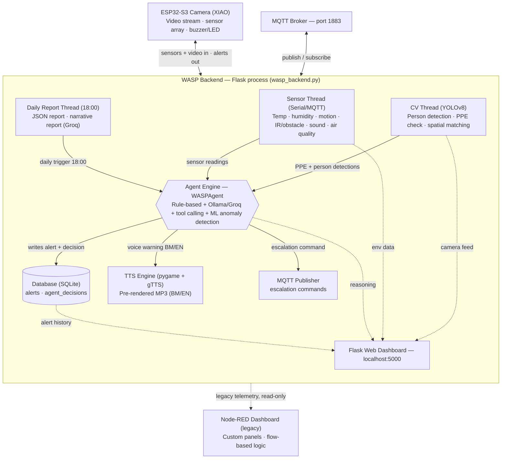

# WASP System Architecture

Warden Autonomous Safety Platform — backend process, agent reasoning, and the hardware and legacy services it talks to.

The Flask backend runs three always-on threads against one shared agent: a **computer-vision thread** checks PPE compliance, a **sensor thread** watches the environment, and a **scheduled thread** compiles a daily report. All three hand their findings to the **agent engine**, which decides whether to log the event, speak a warning, or escalate — writing to SQLite, driving text-to-speech, and publishing alert commands back to the site hardware over MQTT.

**Reading it:** a PPE or environmental anomaly travels through the ingestion threads into the agent engine, which decides to log, speak, or escalate; the dashboard reads live state from that same pipeline rather than sitting at the end of it.

A themed, hover-friendly version of this diagram (with a legend) is at [`wasp-system-architecture.html`](./wasp-system-architecture.html) — open it in a browser.
